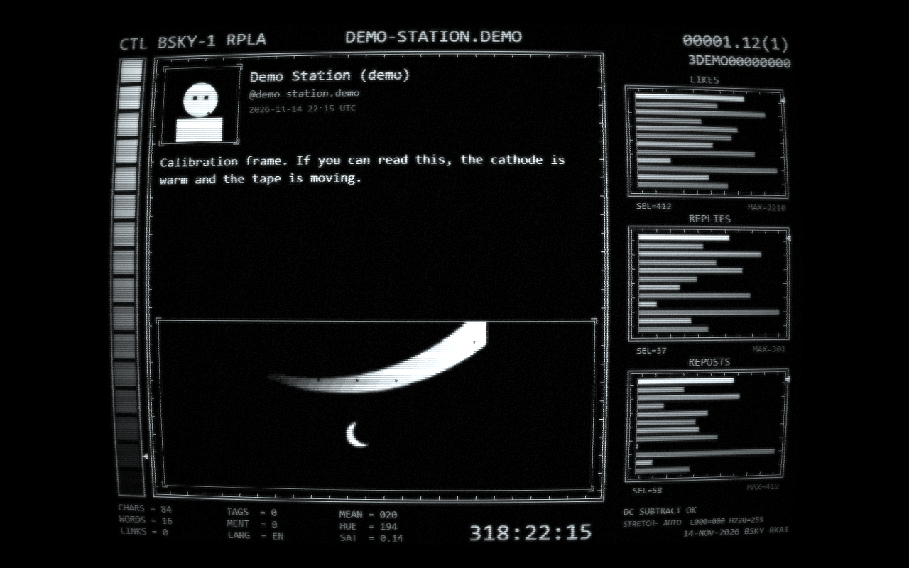

# cathodeskyone

A browser extension for [Bluesky](https://bsky.app): an old image-processing terminal behind your feed, in the style of the planetary probe screens of the 1980s. Every post on the page is a bar in three boxes down the right (likes, replies, reposts). Rest the mouse on a post for a moment and the terminal shows it to the left of the feed: the text, and the author's picture and the post's images in low-res black and white.

The little monitor button at the bottom right switches to the full terminal.

A sibling of [skytreeone](https://github.com/TechyBen/skytreeone) (a forest behind Bluesky) and fightskyone (a sky to fly in).



## Install (unpacked)

```bash
git clone https://github.com/TechyBen/cathodeskyone
```

Then in Chrome or Edge, open `chrome://extensions`, turn on **Developer mode**, click **Load unpacked** and pick the `ext` folder. Open bsky.app. There's no build step.

**Example terminal (demo posts)** in the toolbar popup opens the full terminal in its own tab with made-up posts, no feed needed.

If skytreeone or fightskyone is installed too, switch the others off in their popups: each one puts a scene behind the page.

## Behind the feed

- **Bars** to the right of the feed: one row per post on the page, in page order, length on a log scale against the biggest on the page. The shown post is bright with a marker.
- **The post** to the left of the feed. The terminal waits until the mouse has rested on a post for the settle time (1.5 s by default), so sweeping across the feed doesn't keep switching.
- On a light Bluesky theme the screen is inverted to dark lines on pale paper, like the hard copy.

## Full terminal

| | |
|---|---|
| Up / Down, W / S, mouse wheel | Previous / next post |
| Page Up / Page Down, Home / End | Ten at a time, first, last |
| Click a bar | That post |
| **+** (button or key) | Zoom in: the selected post's thread. Again on a reply: that reply's thread |
| **−** (button or key) | Zoom out: back the way you came, back to the home feed, then round the feed tabs (Following, Discover, your pinned feeds) |
| L | Pictures as grey levels or traced lines |
| Q, or click the quote | Open the quoted post on Bluesky |
| Click a test card | Open the post it stands in for |
| Enter | Open the post's thread on Bluesky |
| Esc | Back to your feed |

## The screen

- **Header**: the author's handle, the post's number on the page, and its record key. Under it, the − and + zoom buttons and where you are (`FEED: DISCOVER`, or `THREAD >>` two threads deep).

Zoom drives Bluesky itself behind the terminal (it opens the thread, goes back, clicks the next feed tab), so the bars always hold what Bluesky would show on that screen. Coming back out, the post you zoomed in from is selected again.
- **Step wedge** (left): the 16 grey levels pictures are cut to, with a marker at the shown picture's average level.
- **Main frame**: the profile picture, name, handle and time, the text, and up to four images (a video's still or a link card's thumbnail too), each in a line-bound box. Pictures are shrunk to about a hundred pixels a side, turned to grey, contrast-stretched between their 1st and 99th percentile and cut to 16 levels, or traced to outlines with an edge filter. Reseau crosses sit over the frame like the marks on the camera's faceplate.
- **Quoted posts** in their own box beside or under the images: who, their first picture (`+N` for more) and their words. What the terminal can't show there (a quoted feed, list or starter pack, a deleted or blocked post, a picture that wouldn't load) becomes a **test card** instead. In the full terminal, click a quote or a test card (or press **Q** for the quote) to open that post on Bluesky.
- **Readouts** along the bottom: characters, words, links, tags, mentions, language; the picture's average level, hue and saturation; the stretch it got (`L011=000 H254=255`: input level 11 went to black, 254 to white); the post's day of the year and time, large, and its date.
- **The tube**: drawn in 2D, then through a WebGL shader with one colour of phosphor, glow, scanlines, line jitter, grain, flicker, a slow rolling band, vignette and, in full screen, a curved face.

## Sound

Medium-low and all synthesised with Web Audio, no samples. It starts once you've clicked or typed on the page (browsers don't allow sound before that).

- **Room tone**: a faint mains hum and tape hiss.
- **A reading of each post shown**: three blips for likes, replies and reposts, each pitched over two octaves by its share of the biggest on the page (log scale).
- **New posts**: a quiet tick for each one that arrives (up to a dozen at once).
- **Tape reels**: a motor whine, rumble and a soft brake clunk when moving between posts or switching to and from the full terminal, and idly every half minute or so.
- **General beeps**: single and double beeps, little falling three-note figures and bursts of telemetry chatter now and then, more often when the posts on the page are busier.

**The voice**: after its reading, each post shown is read aloud by [CHIMERA](https://github.com/jamesondh/chimera-vocal-synth), a physically modelled voice synthesiser (a simulated airway with lungs, vocal folds, tongue and lips; no samples). English text goes to phonemes through the CMU Pronouncing Dictionary, then to articulatory gestures, and the airway runs in an AudioWorklet. Each author gets their own body (male, female, child or between) and pitch from their account's DID, so the same person always sounds the same, played through a small-speaker filter. Links, @, # and emoji are left out, and long posts stop at a sentence end after about 320 characters. Moving to another post cuts it off. **Read posts aloud** in the popup turns it off.

Behind the feed it plays a little quieter than in the full terminal. **Sound** and **Volume** (35% by default) are in the popup.

## Privacy

Only the addresses of the posts on the page (handle and record key) go from bsky.app to the terminal. It fetches the posts from Bluesky's public API and the pictures from Bluesky's CDN. Nothing needs a login, and nothing is stored or sent anywhere else.

## Settings (toolbar popup)

| Setting | Default | |
|---|---|---|
| Terminal behind Bluesky | on | Switching off restores Bluesky exactly |
| Sound | on | Beeps, post readings, tape reels |
| Read posts aloud | on | The CHIMERA voice |
| Volume | 35% | Sound and voice |
| Settle time | 1.5 s | How long the mouse rests on a post before the terminal shows it |
| Pictures as traced lines | off | |
| Terminal glow | 55% | Brightness behind the feed |
| Feed panel | 70% | Opacity of the blurred panel behind the feed |
| Blur | 6 px | |
| Frame cap | 20 fps | Behind the feed; full screen runs at up to 60 |

## Testing without the extension

```bash
python tools/serve.py
```

Then open `http://localhost:8202/term/index.html?demo=1` for made-up, labelled demo posts with drawn pictures (no network). Add `&behind=1` for the behind-the-feed layout, and in the console `__cathode.testLayout(340, 600, true)` to lay it out around a pretend feed column on a light theme. The server's `/proxy?u=` fetches Bluesky's pictures for the page, standing in for the extension's permission.

## Files

- `ext/content.js`, `content.css`: the iframe behind bsky.app, the see-through panels and glass (as in skytreeone), reading the posts on the page, the settle timer, the monitor button, full screen, opening threads.
- `ext/term/`: the terminal page. `main.js` (state, messages, keys, loop), `feed.js` (fetching posts), `picture.js` (fetching and processing pictures), `screen.js` (the layouts and drawing), `crt.js` (the tube shader), `sound.js` (the sounds), `voice.js` (reading posts aloud), `demo.js`.
- `ext/term/voice/`: CHIMERA's engine (`chimera.wasm`), its AudioWorklet (`worklet.js`) and the CMU dictionary, built by `tools/build_voice.sh` from a checkout of [chimera-vocal-synth](https://github.com/jamesondh/chimera-vocal-synth) (MIT; licences alongside).
- `tools/serve.py` (test server), `tools/make_icons.py` (the icon).
